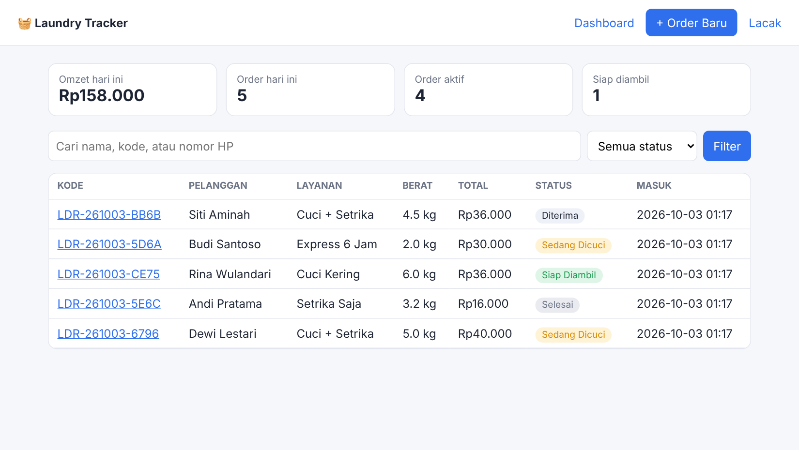
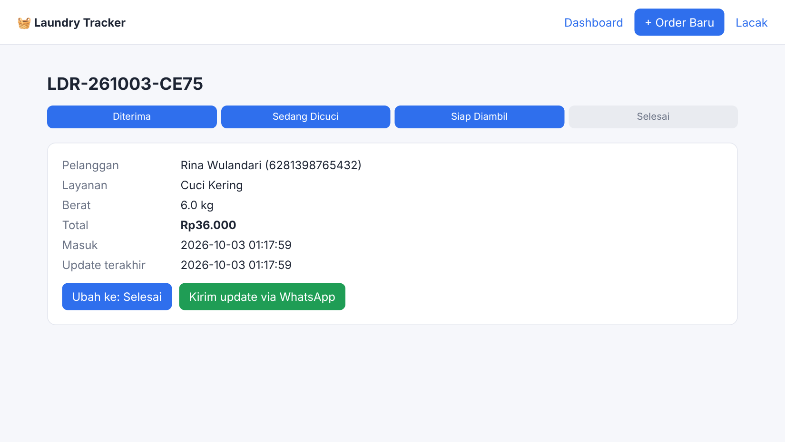

# 🧺 Laundry Tracker


Aplikasi web sederhana untuk usaha laundry kiloan: catat order, hitung harga otomatis, ubah status cucian, dan kirim update ke pelanggan lewat WhatsApp. Pelanggan bisa melacak cuciannya sendiri dengan kode order.

Dibuat dengan **Python + Flask + SQLite**, tanpa framework frontend.





## Fitur

- **Dashboard**: omzet & jumlah order hari ini, order aktif, cucian siap diambil
- **Order baru**: pilih layanan, masukkan berat, estimasi harga tampil langsung (minimal 1 kg)
- **Alur status**: Diterima → Sedang Dicuci → Siap Diambil → Selesai
- **Update via WhatsApp**: satu klik membuka WhatsApp dengan pesan status yang sudah terisi
- **Halaman lacak publik** (`/lacak`): pelanggan cek status tanpa melihat data pribadi pelanggan lain
- **Cari & filter** berdasarkan nama, kode, nomor HP, atau status
- Nomor HP otomatis dinormalisasi (`0812…` / `+62 812…` → `62812…`)

## Menjalankan

```bash
python3 -m venv .venv
source .venv/bin/activate        # Windows: .venv\Scripts\activate
pip install -r requirements.txt
flask --app laundry run --debug
```

Buka http://127.0.0.1:5000. Database dibuat otomatis di folder `instance/`.

## Tes

```bash
pip install pytest
pytest
```

## Struktur

```
laundry/
├── __init__.py    # app factory + filter format Rupiah
├── db.py          # koneksi & skema SQLite
├── services.py    # logika bisnis (harga, status, kode, nomor HP) — mudah dites
├── routes.py      # halaman admin & lacak
├── templates/     # Jinja2
└── static/        # CSS
tests/test_app.py  # unit test + tes alur lengkap
```

Logika bisnis sengaja dipisah dari route (`services.py`) agar bisa dites tanpa server dan mudah dipakai ulang.

## Mengubah harga

Edit dictionary `LAYANAN` di `laundry/services.py`.

## Pengembangan selanjutnya

- Login admin
- Cetak nota (thermal printer)
- Laporan bulanan & ekspor Excel

## Lisensi

MIT
